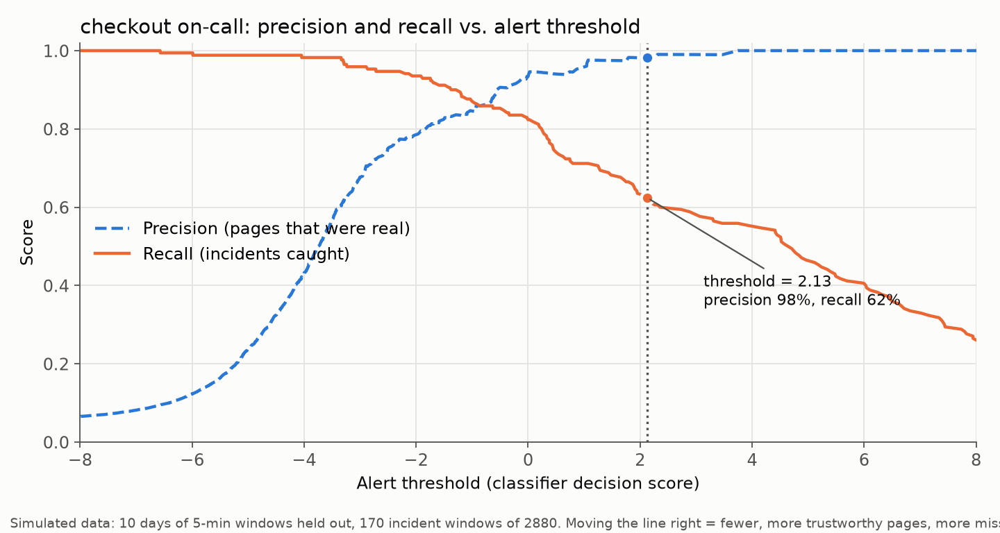
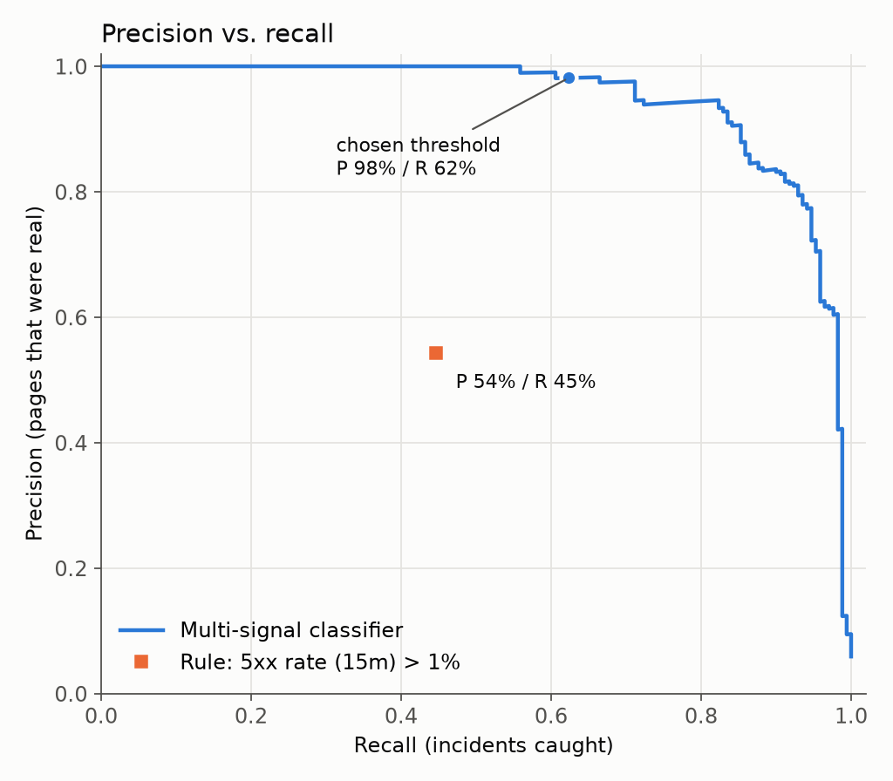
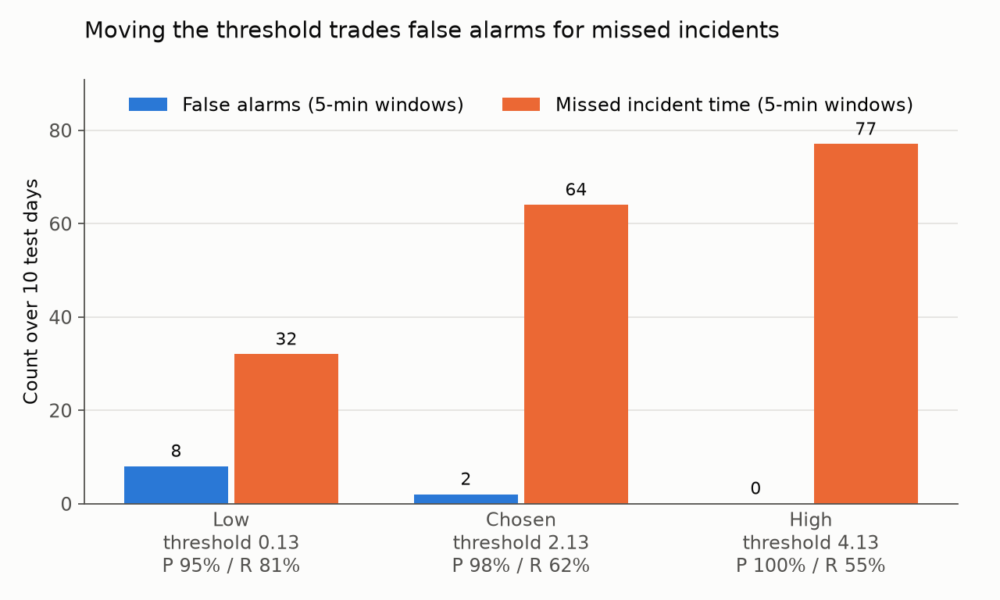

# Your alert rule is a classifier

An alert rule decides "incident" or "no incident", so you can evaluate it like any classifier:
measure its precision and recall, then choose the threshold on purpose instead of by gut feeling.

This repo applies the precision/recall tools from chapter 3 of Géron's *Hands-On Machine Learning*
to alerting on a **simulated** Kubernetes service, and adapts them to how alerting data behaves.



## The scenario (all data is simulated)

- 30 days of 5-minute windows for a `checkout` Deployment: p99 latency, 5xx error rate, pod restarts,
  CPU throttling, memory working set and ready-replica ratio, with a daily traffic cycle.
- 45 labelled incidents of four kinds (OOM, failing dependency, crashloop, slow database), some deliberately subtle.
- Noise that looks bad but isn't an incident: 120 rolling deploys and 60 nightly batch jobs.
- Time-based split: train on days 1–14, pick the threshold on days 15–20, test on days 21–30.
  The test set never influences a choice. About 6% of test windows are incident time.

The model is a logistic regression on all signals. Its decision score is what the threshold moves along,
as with `decision_function` in the book. The default threshold is the lowest one reaching 90% precision on the validation days.

## Results on the 10 test days

|  | Precision (window) | Recall (window) | False-alarm windows | Precision (incident) | Recall (incident) | False alert episodes |
|---|---|---|---|---|---|---|
| Classifier, threshold −0.43 | 91% | 84% | 15 | 70% | 16 / 17 | 11 |
| Rule: 5xx rate over 15 min > 1% | 54% | 45% | 64 | 41% | 13 / 17 | 24 |



The single-metric rule sits well inside the classifier's curve: several signals together give a better model,
not just a better threshold.

### Moving the threshold



No setting is "correct". Which one to use depends on what a missed incident costs compared with a false page.

### Per window vs. per incident

The same predictions look different depending on what counts as a positive:

- **Per window:** every 5-minute window is scored on its own. Catching 3 windows of a 6-window outage gives 50% recall.
- **Per incident:** an incident counts as caught if any window is alerted. An *alert episode* is a run of
  consecutive alerted windows, and it's a false alert if it overlaps no incident.

At the chosen threshold, the classifier catches 16 of 17 test incidents even though per-window recall is 84%.
But per-incident precision drops to 70%, because the false alarms are short, separate blips: 15 false windows
make 11 separate false pages. In practice, a pending duration (Prometheus `for:`) would suppress many of them.

## Run it

With [uv](https://docs.astral.sh/uv/):

```bash
uv run main.py                  # default: threshold for >= 90% precision
uv run main.py --precision 0.8  # try another precision target
```

`uv run` creates the virtual environment and installs the locked dependencies on first use.
Run the tests with `uv run pytest`.

This writes the dataset to `data/` and the figures to `figures/`, and prints the table above.
The seed is fixed, so results are reproducible.

## Layout

| File | What it does |
|---|---|
| `simulate.py` | Generates the fake Kubernetes metrics, incidents and noise |
| `evaluate.py` | Time-based split, training, threshold choice, per-window and per-incident metrics |
| `plots.py` | The three figures |
| `main.py` | Runs everything and prints the results table |
| `tests/` | Unit tests for the metrics and threshold choice |

## Caveats

- All numbers depend on how the data was simulated. They demonstrate the method, not a benchmark.
- Incident boundaries are exact here. Real labels from post-mortems are approximate.
- Logistic regression is deliberately simple. The point is how to evaluate and choose, not the model.

## License

MIT
